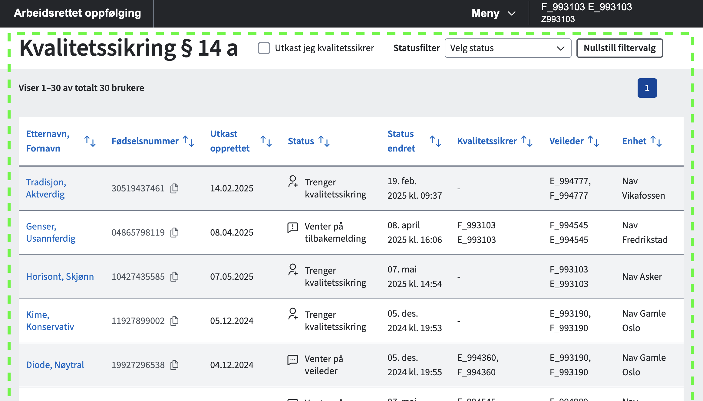

# Frontend for kvalitetssikringsoversikt

Intern applikasjon for å vise oversikt over brukere under kvalitetssikring av § 14 a-vedtak.

Enhetsfilter og midlertidig tilgang styres av Unleash-bryteren
`beslutteroversikt.enhetsfilter_og_enkelttilgang`. Når bryteren er av eller mangler i svaret,
vises ikke enhetsfilteret, søket begrenses ikke på enhet, og de nye endepunktene kalles ikke.
Bryteren er på som standard i lokale testdata. Sett den til `false` i
`src/mock/handlers/mock-obo-unleash.ts` for å prøve den gamle visningen lokalt.

Når bryteren er på, støtter enhetsfilteret valg av flere enheter med utkast til kvalitetssikring. Listen hentes fra
`GET /veilarbvedtaksstotte/api/beslutteroversikt/enheter` og viser både `medTilgang` og `utenTilgang`.
Enhetene i `medTilgang` er valgt som standard ved oppstart. Søk på navn eller
enhetsnummer i feltet, og fjern valgte enheter for å utvide søket igjen. Uten valgte enheter
begrenses ikke søket på enhet.
«Nullstill filtervalg» fjerner både status- og enhetsfilteret. Enhetsfeltet viser «Alle enheter»
når ingen enheter er valgt.

Ved åpning av utkast fra en enhet i `utenTilgang` gis midlertidig tilgang gjennom
`POST /veilarbvedtaksstotte/api/v1/tilgang/enkelttilgang` med `{ "brukerId": "<fødselsnummer>" }`.
Først etter svar med status 204 settes brukerkonteksten og oppfølgingsvedtaket åpnes.
Ved feil blir veilederen værende i oversikten og får en feilmelding.
Utkast fra enheter i `medTilgang` åpnes uten dette tilgangskallet.

Testversjon av løsningen: [https://navikt.github.io/beslutteroversikt](https://navikt.github.io/beslutteroversikt)

